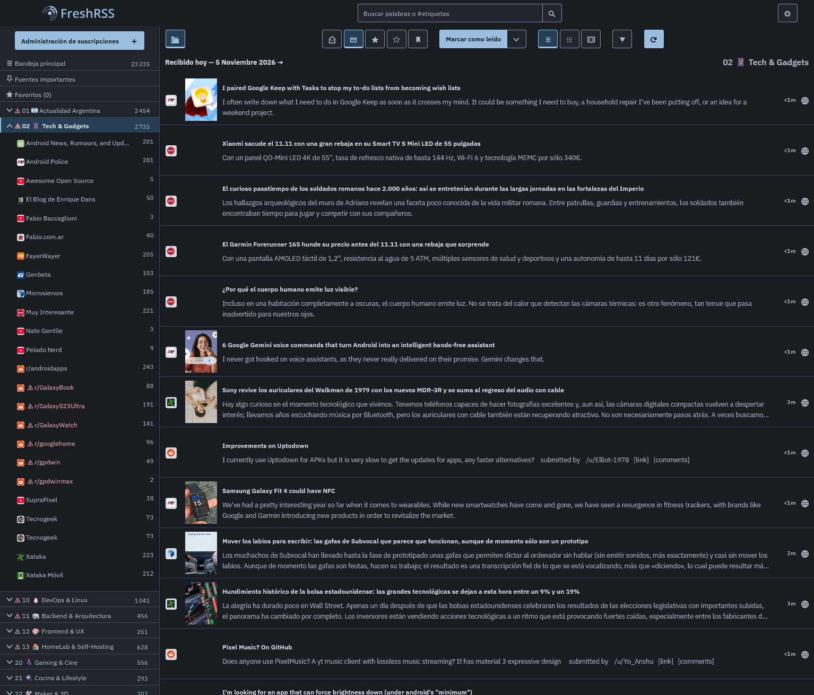
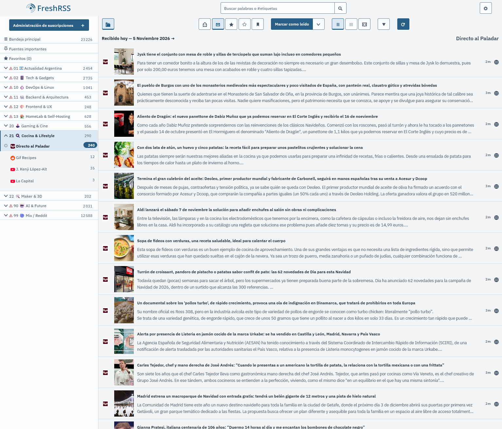

# Flatcap for FreshRSS

  

  

  

Flatcap Slate (dark) above, Flatcap Daylight (light) below.

**Flatcap for FreshRSS** brings the Flatcap visual system to your feed reader: matte graphite surfaces, one mineral-blue accent, IBM Plex for the interface and the reading column, Cascadia for code.

It is a single stylesheet for FreshRSS's **User CSS** extension, built on top of the **Nord** theme, with two independently tuned modes, **Slate** (dark) and **Daylight** (light), plus a version that follows your operating system.

> The interface organizes. Content takes the foreground. Color informs.

## Install

1. **Choose the base theme.** In FreshRSS, open **Configuration → Display** and set **Theme** to **Nord**. Flatcap re-colors Nord's structure, so this step is required.
2. **Enable the extension.** Open **Configuration → Extensions** and enable **User CSS**.
3. **Open its settings.** Click the extension's name (or its gear) to open the settings page. It has a single text area.
4. **Paste the stylesheet.** Copy the full contents of one of the three files listed in [Use it](#use-it), paste it into the text area, and press **Submit**.
5. **Reload FreshRSS.** The theme applies on the next page load.

> **Fonts.** After step 5 the interface works, but IBM Plex and Cascadia will only appear if FreshRSS is allowed to load them. See [Fonts](#fonts).

## Use it

Pick the file that matches the mode you want. All three share the same rules and differ only in the color tokens they define.

| File                   | Use it when                                                     |
|:---------------------- |:--------------------------------------------------------------- |
| `flatcap.css`          | You want **Slate**, always dark.                                |
| `flatcap-daylight.css` | You want **Daylight**, always light.                            |
| `flatcap-system.css`   | You want Slate or Daylight to follow the OS light/dark setting. |

To switch modes later, replace the pasted text with another file. To go back, empty the text area.

## Fonts

Flatcap uses IBM Plex Sans and Cascadia (see the [Flatcap typography guide](https://github.com/cheycron/flatcap-theme/blob/main/docs/typography.md)). The stylesheet starts with an `@import` of IBM Plex Sans, Cascadia Code and Cascadia Mono from Google Fonts.

**FreshRSS blocks it by default.** Out of the box FreshRSS sends a Content Security Policy of `default-src 'self'`. That also governs styles and fonts, so the browser refuses the Google Fonts stylesheet and the font files it points to. Nothing breaks: the font stacks include fallbacks (Segoe UI, `system-ui`, `ui-monospace`, Consolas), and the layout and colors are unaffected. You simply see system fonts instead of Plex and Cascadia.

Pick one of these:

**Option A: install the fonts locally (recommended).** Nothing to change in FreshRSS, and no third-party requests. Install **IBM Plex Sans**, **Cascadia Code** and **Cascadia Mono** on the devices you read on. The stylesheet names them as local families, so they are used as soon as they exist. The blocked `@import` is harmless; you may delete that line from your pasted copy.

**Option B: allow Google Fonts in your CSP.** If you control the web server or reverse proxy in front of FreshRSS, extend the policy it sends so that:

- `style-src` includes `'self'` and `https://fonts.googleapis.com`
- `font-src` includes `'self'` and `https://fonts.gstatic.com`

Keep the rest of your policy unchanged. This makes every browser request fonts from Google, so prefer Option A if privacy matters to you. How to set the header depends on your deployment (Apache, nginx, Caddy, a container image); this repository does not change it for you.

## Accessibility

- **Contrast.** Text, borders, focus rings, alerts and syntax colors were measured in the running interface in both modes against the contracts of the [Flatcap core](https://github.com/cheycron/flatcap-theme). The ratios met their targets, for example body text above 7:1 and secondary text above 5:1. `python3 scripts/build.py --check` fails if the generated stylesheets are stale.
- **Increased contrast.** `prefers-contrast: more` switches to stronger text and border colors.
- **Focus and state.** A 2px ring with a 2px offset on every focusable control; the current feed or article carries an accent edge and a heavier weight, never color alone.
- **User preferences.** Transitions are disabled with reduced motion, active states keep an outline under forced colors, and controls grow to a 44px target on coarse pointers.

## Compatibility

- **FreshRSS 1.30**, with the **Nord** base theme and the **User CSS** extension (tested with 1.30.0 and User CSS 1.1.2).
- Other FreshRSS versions or base themes may work, but they are not tested. Flatcap styles Nord's markup, so a different base theme will not look right.
- Rendering was checked in Chromium. Other browsers are not tested.

## Contributing

The three stylesheets are generated from `src/theme.json` and `src/rules.css`; do not edit them by hand. Run `python3 scripts/build.py --check` before opening a pull request.

## License

MIT © Cheycron Blaine. See [LICENSE](https://github.com/cheycron/flatcap-theme/blob/main/LICENSE).

## Support

If Flatcap makes your workspace calmer, you can support its development.

  

